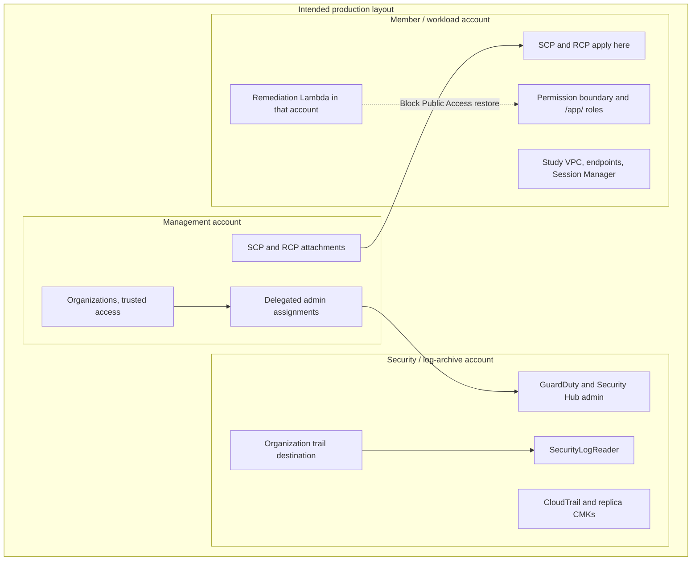
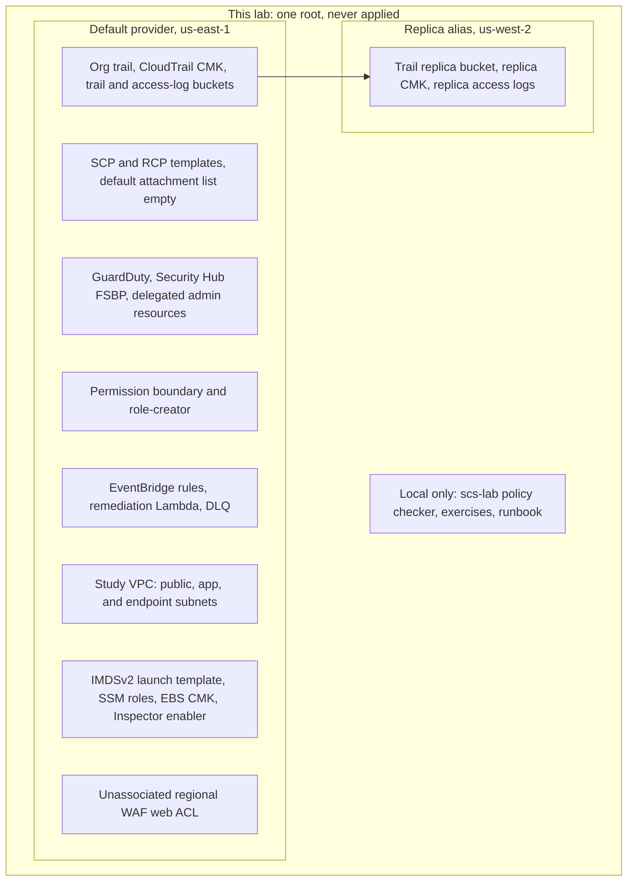

# Architecture

Draft, pending independent fact-check. Written against the published tree at
[`d9fd76b`](https://github.com/mikedsosa/aws-security-specialty-lab/commit/d9fd76b0fc786deb5c5350cbaeac6c87f10fe3a3)
(the Domain 3 publish on main). Nothing in this document was observed in a
live AWS account. It explains why the lab is shaped the way it is, not how to
deploy it. Do not apply this lab as-is.

The companion threat model is [threat-model.md](threat-model.md).

## 1. Context and goals

This is an offline SCS-C03 study architecture. The audience is a reviewer who
has already read the [README](../README.md). The goal is to make organization
guardrails, logging, key policy, detection, remediation, and a small network
and compute design concrete as code that can be planned, scanned, and tested
on a laptop.

The exam guide (SCS-C03 v1.0, published March 26, 2026, read November 17,
2026) and the skill mapping live in [exam-domain-map.md](exam-domain-map.md).
This file does not repeat that table.

## 2. Relation to aws-audit-baseline

[mikedsosa/aws-audit-baseline](https://github.com/mikedsosa/aws-audit-baseline)
is a single-account design: a single-account trail, per-bucket KMS keys,
account-level Block Public Access, MFA-conditioned roles, and a plan-evidence
checker. That write-up is not repeated here.

This lab adds the organization layer and the study material that goes with
it: an SCP and an RCP, an organization trail, delegated-admin assignments for
GuardDuty and Security Hub, permission-boundary delegation, EventBridge-driven
auto-remediation, and the Domain 3 study VPC. Where the two overlap (TLS-only
buckets, SSE-KMS, log file validation, MFA on role trust), this lab keeps the
organization-shaped version only.

## 3. Intended production layout vs this lab

In a production organization the functions below are split across accounts
and often across Regions:

- A management account holds Organizations, trusted access, SCP and RCP
  attachments, and the assignments of delegated administrators. It should
  not hold workload VPCs, application roles, or the log archive.
- A security or log-archive account holds the organization trail's destination
  buckets, the CloudTrail and replica keys, log readers, and the delegated
  GuardDuty and Security Hub administration. In a real organization,
  `aws_guardduty_organization_configuration` is created in the delegated
  admin account after the admin assignment is accepted.
- Member or workload accounts receive the SCP and RCP, run a Session Manager
  access path and any study VPC, and run a copy of the remediation function
  in each account and Region that has buckets to protect.

This lab compresses that layout into one Terraform root so an offline plan
can include it. There are two AWS providers, not one: the default provider
in `var.region` (default `us-east-1`) and a `replica` alias in
`var.replica_region` (default `us-west-2`) for the trail replica bucket and
its key. Placeholder IDs still name a management account (`111122223333`) and
a security account (`444455556666`). Member account `777788889999` appears in
tests, exercises, and the runbook only; it is not a Terraform variable.

The compression has a consequence the threat model treats as residual risk:
SCPs and RCPs do not apply to the management account, and this root places
the trail, CloudTrail key, log buckets, detection resources, remediation
Lambda, identity roles, and study VPC on that account's placeholders.
`terraform/detection.tf` also states that applying the GuardDuty organization
configuration from the management account would not work.

## 4. Control placement by exam domain

Pointers are to files, not to a live environment.

### Foundations and governance (domain 6)

`terraform/governance.tf` and the SCP/RCP templates. The SCP denies leaving
the organization, root-user actions, a listed set of telemetry-tampering
APIs, account-level Block Public Access changes, and API calls in Regions
outside `var.allowed_regions`, with `BreakGlassAdmin` exempted from the last
three of those (not from leaving the org or from root-user actions). The RCP
denies non-TLS requests on a short list of services and denies S3 access from
identities that are not in the organization and are not AWS services.
Exercises 1, 2, and 8 sit here, with TFLint in `terraform/.tflint.hcl`.

### Data protection (domain 5)

`terraform/logging.tf`, `terraform/log-archive.tf`, the CloudTrail and EBS
key policies, and the VPC endpoint policies. The organization trail is
multi-Region, includes global service events, enables log file validation,
and encrypts with a customer managed key. The trail bucket uses SSE-KMS,
versioning, ownership enforced, Block Public Access, a TLS-only and no-delete
policy, S3 access logging, EventBridge notifications, and replication to
us-west-2. Access-log destination buckets use SSE-S3 and do not log to
themselves, following AWS guidance. Endpoint policies restrict S3, Systems
Manager, and CloudWatch Logs from the study VPC. Exercises 2 to 4, 10, and 14.

### Identity (domain 4)

`terraform/identity.tf` and the Session Manager roles in
`terraform/compute.tf`. A permission boundary caps `/app/` roles at a short
allow list and denies IAM, Organizations, and `sts:AssumeRole`. The
role-creator role can manage `/app/` roles only with that boundary and cannot
remove or edit it. The Session Manager operator and role-creator trust
policies require MFA. The launch template issues no SSH key. Exercises 5 and
13. The local checker in `src/scs_lab/policy_eval.py` is for "predict the
decision" drills, not for combining policies the way AWS does.

### Detection and incident response (domains 1 and 2)

`terraform/detection.tf`, `terraform/remediation.tf`, `terraform/logging.tf`,
`lambda/remediate_s3_bpa/handler.py`, and
[runbook-s3-public-exposure.md](runbook-s3-public-exposure.md). GuardDuty is
enabled with S3 protection and `auto_enable_organization_members = "ALL"`.
Security Hub CSPM is enabled with the AWS Foundational Security Best
Practices standard and a delegated-admin assignment. There is no Security
Hub organization auto-enable resource. Two EventBridge rules send CloudTrail
Block Public Access API calls and the GuardDuty finding
`Policy:S3/BucketBlockPublicAccessDisabled` to a Lambda function that turns
bucket-level Block Public Access back on. The function is idempotent,
supports an exemption list and a dry-run flag, and has a DLQ, retries, and
reserved concurrency. Exercises 3, 6, and 7.

### Infrastructure (domain 3)

`terraform/network.tf`, `terraform/compute.tf`, and `terraform/edge.tf`. The
study VPC is `10.42.0.0/16` by default, split across two named Availability
Zones into public, app, and endpoint subnets. Public subnets have an internet
gateway, `map_public_ip_on_launch = false`, and no workload resource in this
lab. App and endpoint route tables have no internet gateway and no NAT
gateway. Flow logs go to a CloudWatch log group encrypted with
`aws_kms_key.infra_logs`. The launch template requires IMDSv2, encrypts the
root volume with a customer managed key, attaches the Session Manager
instance profile, and does not set a key pair. Inspector v2 is an enabler
resource for EC2, ECR, and Lambda, default on, and was not run. The WAF web
ACL is regional, includes the Core Rule Set, Known Bad Inputs, and a
rate-based rule of 1000 requests per IP, and is not associated with a
resource. Exercises 9 to 15.

## 5. Decision records

These are the design choices that a reviewer is most likely to question.
Each is already visible in the Terraform comments or the README.

| Decision | Why the lab does it this way |
| --- | --- |
| EventBridge plus Lambda for Block Public Access remediation; no CloudWatch Logs delivery on the trail | The function can restore a control from the same management events EventBridge already receives. CloudWatch Logs delivery for the trail is a paid add-on and is left out (`CKV2_AWS_10` is documented, not "fixed" by adding that delivery). |
| Session Manager instead of SSH | The launch template does not set `key_name`. The operator policy has session APIs and not `ssm:SendCommand`. App security groups have no inbound rules. Network ACLs deny TCP 22. |
| Unassociated WAF web ACL | The ACL is there to study managed rules, a rate-based rule, and logging. Associating it would imply traffic inspection that this lab does not have (there is no load balancer, API Gateway, or CloudFront distribution). |
| SSE-S3 on access-log destination buckets, with documented checkov exceptions | AWS requires SSE-S3 on a server access log destination and recommends against a destination logging to itself. Directory-mode checkov still flags `CKV_AWS_18` and `CKV_AWS_145` on those buckets; both are skipped in the code for that reason. Plan mode flags `CKV_AWS_145` and did not flag `CKV_AWS_18`. |
| Inspector v2 enabler default on | The resource is part of the Domain 3 study path. The README warns that an apply would bill for Inspector and would start scanning in the account, including existing images or functions, and that Inspector was not run, so there are no findings. `enable_inspector` can be set to false. |
| One root module and two providers | An offline `terraform plan` can include the organization trail, the replica Region, detection, remediation, and the study VPC without assuming roles or talking to AWS. The cost of that choice is the management-account compression described in section 3. |
| `0.0.0.0/0` stand-in on the S3 path | The regional S3 managed prefix list cannot be looked up offline. The security group and network ACL comments, and the README, say a live account should use the prefix list instead. |
| Remediation Lambda stays out of the study VPC | The function only calls the S3 control plane. Placing it in the VPC would add interface-endpoint or NAT cost without reducing that API exposure (`CKV_AWS_117` is documented). Its identity policy is also scoped to `aws:ResourceAccount` of the management account, which is consistent with the compressed root and is not a multi-account remediator. |
| Trail records management events only | The event selector sets `include_management_events = true` and does not add S3 data events. The runbook tells the reader that management events do not show `GetObject`, and not to report "no data accessed" when data events and workload access logs were both off. |
| GuardDuty organization configuration lives in this root, without `count` on the detector | checkov 3.1.47's `CKV2_AWS_3` graph check does not connect counted resources. The lab keeps the setting visible to the offline plan and records that applying that resource from the management account would not work. |

## 6. What is not in this architecture

Not present, and not implied by the plan: Network Firewall, CloudFront,
Shield Advanced, Image Builder, Patch Manager runs, GenAI guardrails, hybrid
connectivity (Site-to-Site VPN, Direct Connect, MACsec), Verified Access,
IAM Identity Center, Cognito, Secrets Manager rotation, imported key
material and external key stores, Macie, Security Lake, Detective, AWS
Config recorders or conformance packs, Control Tower, Audit Manager, and
Artifact. The domain map lists the same exam-scope exclusions.

The lab also does not create the `KeyAdmin`, `TerraformDeployer`,
`SecurityLogReader`, or `BreakGlassAdmin` roles it names. It does not create
a workload bucket such as the runbook's `scs-lab-app-data`. It does not
create an EC2 instance from the launch template. It does not attach the SCP
or RCP unless `guardrail_target_ids` is set.

## 7. Operational notes for a later, real design

This is not a deployment guide. A reader who wants to reuse the ideas in an
organization they own would still need to do at least the following, in that
organization, under their own change control:

- Start from an existing organization with SCPs and RCPs enabled, and with
  trusted access for CloudTrail, GuardDuty, and Security Hub.
- Split management, security or log-archive, and member accounts. Create
  `aws_guardduty_organization_configuration` in the delegated admin account.
  Deploy the remediation function in each account and Region that needs it.
- Create and tightly control the named key-admin, deployer, log-reader, and
  break-glass roles before writing key policies that name them.
- Set `guardrail_target_ids` to the roots, OUs, or accounts that should
  receive the SCP and RCP. Leave the management account out of those
  attachments for the usual AWS reason, and do not put the log archive there.
- Replace placeholder AMI and account IDs. Use the regional S3 prefix list
  instead of `0.0.0.0/0`. Associate a WAF ACL only when there is a resource
  that should be inspected. Review Inspector's default-on behavior and cost
  before enabling it in an account that already has images or functions.

Until those changes exist in a different design, treat this repository as an
offline study plan. Do not apply this lab as-is.
